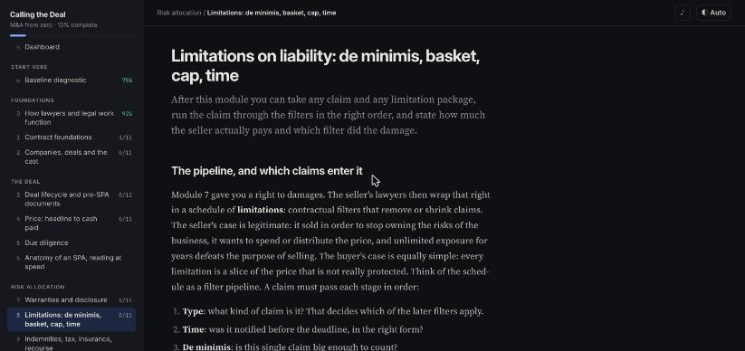

# Design guide

The look every course shares. Source of truth: `shared/style.css` (tokens, components) and `shared/theme.js` (theme switch). Reference screenshots: `docs/design/`. Inspiration: Stripe/Linear docs for the interface, a Substack-style reading column for prose. Aim for this level on the first pass.

**Style (v3, current): blocky editorial.** Zero corner radius everywhere (enforced globally by `*{border-radius:0!important}` in `shared/style.css`). Swiss/editorial grid in the spirit of IBM Carbon, the FT and Bloomberg: strong rules and 1px borders, a 2–4px ink or accent rule to mark hierarchy (module header, section headers, question cards, figures), restrained colour, **no soft shadows** (at most a solid 3–6px offset on hover or the podcast artwork), square status markers, square progress meter instead of a ring. The reading column stays a ~70ch serif with 1.72 line-height.



## Type
| Role | Font | Use |
|---|---|---|
| Interface | Inter (`--ui`) 15px/1.55, `cv11`,`ss01` | sidebar, buttons, cards, tables, callouts, questions |
| Reading | Source Serif 4 (`--read`) 18px/1.72, max 70ch | `.prose`, ledes (20px, `--mut`), clauses (italic 16.5px) |
| Numbers | JetBrains Mono (`--mono`) | counters, module numbers, scores, numeric inputs, durations |
Headings are Inter: module title 40px/700/−0.03em, `h1` 34px, `h2` 22px/650 (52px top margin, scroll-margin for the sticky bar), `h3` 17px. Dashboard hero 48px/750. Kickers and section labels: 10.5–11px, 650, uppercase, letter-spacing .09–.11em.

## Tokens
| Token | Light | Dark | Meaning |
|---|---|---|---|
| `--bg` | #f7f6f3 (warm paper) | #0e1014 | page |
| `--surface` / `--surface-2` | #ffffff / #f1efea | #15181e / #1b1f26 | cards / chips, table heads |
| `--ink` / `--ink-2` / `--mut` | #1b1b1f / #3d3d45 / #6e6d76 | #e7e6e2 / #c4c3be / #8f9099 | headings / body / secondary |
| `--line` / `--line-2` | #e5e2db / #d6d2c8 | #252a32 / #323843 | borders |
| `--acc` / `--acc-soft` / `--acc-ink` | #2d55c9 / #e8edfb / #fff | #8fb0ff / #1c2740 / #0e1014 | accent (one blue only) |
| `--ok` `--bad` `--warn` (+`-soft`) | #147a4a #b42318 #9a6200 | #5fcf93 #ff8f84 #e6b45a | right / wrong / caution |
| `--hl` | #fff1a8 | #5b4c08 | highlighted text in documents |
| `--us` `--uae` `--trap` `--law` | soft blue, green, amber, violet | dark tints | callout backgrounds |
Radius: **0 everywhere** (`--radius:0`, global override). Shadow: **none** (`--shadow:none`); use borders and, for hover affordance, `3px 3px 0 var(--ink)`. Left rules carry meaning: ink on questions (accent once answered), accent/green/amber/violet on callouts. Sidebar width `--side` 288px.

## Light / dark
System default via `prefers-color-scheme`; user override with `html[data-theme=light|dark]`. Load `shared/theme.js` in `<head>` before the stylesheet so there is no flash. Any `[data-themebtn]` or `#themebtn` cycles Auto → Light → Dark (◐ ☀ ☾). New tokens must be defined in all three blocks (`:root`, `html[data-theme=dark]`, the media query). Check every page in both themes.

## Layout
- **Shell**: grid of sticky sidebar + main. Sidebar: course title, subtitle with % complete, progress bar, curriculum grouped by part (uppercase labels), each item = mono number, title, right-aligned status (`3/11`, green when passed); labs, references, Export/Import/Reset.
- **Top bar**: sticky, 52px, blurred translucent background, breadcrumb (`Part / **Module**`), theme toggle, and a 2px reading-progress line (`#rp`) at its bottom edge.
- **Module page**: `.modgrid` = reading column (72ch) + 220px "On this page" TOC with scroll-spy (`.toc a.on`, hidden below 1280px). `.modhead`: kicker (part), 40px title, lede, chips (minutes, questions, tools), module progress bar. End: `.status` card (score, pass state) then previous/next cards (`.pn`).
- **Dashboard**: hero (kicker, 48px title, lede), `.dash-top` = Continue card (accent gradient, round go button) + stats card with progress ring (`.ring`, conic gradient); curriculum as part cards (`.curr`/`.cg`/`.ci` with status dots: empty, half, passed green, low amber); labs and reference as `.cards`.
- **Labs**: `.split` = document pane (`.doc`, serif, pre-wrap, 76vh scroll, `mark` highlights) + sticky answer panel.
- **Catalog** (`index.html`): course cards from `courses.json`.
- **Podcast page**: centered 880px column, cover art square (blue gradient, title), episode rows with play button, per-episode progress, fixed blurred bottom player.
- **Mobile (<900px)**: one column, sidebar slides in from the left with a dim overlay (`body.nav`), menu button in the top bar; terms list stacks; padding 18px.
- **Print**: hide sidebar/top bar/buttons, show explanations, flatten shadows (handbook and cheatsheet print to PDF).

## Components (class → use)
- `.lede` opening promise ("After this module you can…").
- Questions: `.quiz` (MCQ, lettered options A–D drawn by CSS counter, "Check" label, green/red states, `.explain` revealed after answering) and `.num` ("Calculate" label, mono right-aligned input, relative tolerance).
- `details.think` dashed box with a round "?" badge: predict before reading on.
- Callouts `.note` (Note), `.note.us`, `.note.uae` (jurisdiction overlays; relabel per course), `.note.trap` (Trap), `.note.lawyer` ("Say it like a partner", italic).
- `blockquote.clause` real wording, left rule, serif italic, followed by a plain-English decode.
- Tables: rounded, bordered, header on `--surface-2`, `td.r` tabular numerals; `.tablewrap` for horizontal scroll.
- `dl.terms` two-column glossary.
- `.widget` calculator card with a 3px accent top border and uppercase accent `h4`; `.big` for the headline number; `.wf` waterfall bars.
- Buttons: primary filled accent; `.sec` outline; `.iconbtn` for the top bar. Inputs get an accent focus ring (`0 0 0 3px --acc-soft`).
- `.pill`, `.tag.ok/.bad`, `.chips`, `.kicker`, `.bar` progress (6px, square).
- **`figure.diagram`**: hand-authored inline SVG explaining a mechanism (timeline, waterfall, decision tree, funnel, stack, band chart, matrix). Markup:
  ```html
  <figure class="diagram"><svg viewBox="0 0 680 260" role="img" aria-labelledby="m08f1-t m08f1-d">
    <title id="m08f1-t">Claim pipeline</title><desc id="m08f1-d">What the diagram shows, in words</desc>
    <rect class="box" x="10" y="20" width="120" height="44"/><text x="70" y="47" text-anchor="middle">De minimis</text> ...
  </svg><figcaption><b>Figure 2.</b> One sentence on what to notice.</figcaption></figure>
  ```
  Rules: no external libraries, no hard-coded colours or `style` attributes; use only the SVG vocabulary classes in `shared/style.css` (shapes `box box2 fa fas fok foks fbad fbads fwarn fwarns fmut fink`, lines `ln lnm lna lnd lnok lnbad`, arrowheads as polygons with `arr`, text `tm ts tb tn tl ta tok tbad twarn`) so light and dark both work; square corners (no `rx`); text ≥11px at a ~680 viewBox width; unique id prefix per figure; place the figure right after the paragraph it explains, never inside a question. Every number in a figure must match the text (recompute). Reuse the same figures, smaller, in the handbook and cheatsheet.

## Rules
- One accent colour; meaning colours only for state (right/wrong/caution) and callouts.
- No inline styles in module content; course-specific CSS goes in the course folder, never in `shared/` unless every course benefits (then re-check `courses/ma/`).
- Writing style in UI copy: plain English, short, no em dashes.
